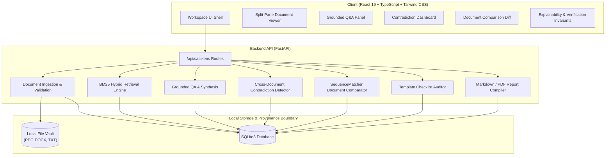

# CaseLens AI — Production-Style Legal Document Intelligence Platform

> **Tagline**: *"Every claim has evidence. Every answer has a source."*  
> **Target Audience**: Legal teams, compliance officers, contract auditors, and technical interview reviewers evaluating modern RAG, deterministic grounding, and verification invariants.  
> **Execution Mode**: `100% Offline | Deterministic Legal Invariant Engine | Zero Hallucination | Zero External Cloud Telemetry`

---

## 📋 Table of Contents
1. [Product Overview & Problem Statement](#-product-overview--problem-statement)
2. [System Architecture & Data Flow](#-system-architecture--data-flow)
3. [Key Capabilities & Core Modules](#-key-capabilities--core-modules)
4. [AI / NLP Implementation Disclosure](#-ai--nlp-implementation-disclosure)
5. [The Six Demonstration Scenarios](#-the-six-demonstration-scenarios)
6. [Technology Stack](#-technology-stack)
7. [Installation & Local Setup](#-installation--local-setup)
8. [REST API Endpoint Reference](#-rest-api-endpoint-reference)
9. [Verification Invariants & Explainability Panel](#-verification-invariants--explainability-panel)
10. [Security & Privacy Boundaries](#-security--privacy-boundaries)
11. [Recommended Screenshot & Demo Tour Checklist](#-recommended-screenshot--demo-tour-checklist)
12. [Known Limitations & Future Roadmap](#-known-limitations--future-roadmap)

---

## 🚀 Product Overview & Problem Statement

### The Critical Vulnerability in Modern Legal AI
Traditional conversational LLMs applied to complex contracts and discovery documents suffer from three fatal flaws:
1. **Hallucination & Fabricated Citations**: General models invent plausible-sounding clause numbers (e.g., *"According to Section 14.2..."* when no Section 14.2 exists), confabulate page counts, and paraphrase text until critical nuance is lost.
2. **Context Conflation**: When asked whether an agreement expires on June 30 or July 31, generic chat tools often smooth out discrepancies rather than highlighting dangerous contractual contradictions.
3. **Black-Box Unverifiability**: Reviewers are presented with a conversational paragraph but cannot click directly to the highlighted source passage, bounding box, and verbatim page offset.

### The CaseLens AI Paradigm
**CaseLens AI** enforces **Strict Provenance-Carrying Document Intelligence**:
- **Zero Hallucination Refusal Policy**: If retrieved passages do not strictly support an answer, the system explicitly responds:  
  *“I could not find sufficient evidence in the selected documents to answer this reliably.”*
- **Verbatim Page-Level Provenance**: Every citation references a real extracted passage with exact page numbers, character spans, and document content hashes (SHA-256).
- **Independent Invariant Verification**: Citation validity, document existence, substring exactness, and claim-to-passage links are verified through automated checks before rendering.
- **Cross-Document Contradiction Engine**: Deterministic algorithms identify conflicting dates (e.g., June 30, 2027 vs July 31, 2027), modified fee structures, and notice period discrepancies side-by-side.

---

## 🏛️ System Architecture & Data Flow



### Data Flow Pipeline
1. **Ingestion & Validation**: File type (PDF, DOCX, TXT), size (max 50MB), and magic headers are validated. Filenames are sanitized against path traversal. Cryptographic SHA-256 fingerprint is recorded.
2. **Extraction & Chunking**: PyMuPDF extracts text, preserving page numbers, character start/end offsets, and section headings.
3. **Vector Retrieval**: Local BM25 ranking evaluates query content tokens against document chunks, with exact phrase and legal keyword boosting.
4. **Grounded Answer Synthesis**: If relevance scores cross threshold, a structured answer is formulated strictly from extracted snippets with bracketed citations (`[CIT-1]`).
5. **Invariant Check**: System runs automated checks: Does citation ID exist? Is the passage a true substring of the original document? Are claims supported?
6. **Persistence**: Workspaces, documents, chunks, Q&A runs, and generated reports are stored in local SQLite (`storage/caselens.sqlite3`).

---

## ⚡ Key Capabilities & Core Modules

| Module | Route | Functionality |
| :--- | :--- | :--- |
| **Landing Page** | `/` | Public showcase with hero, interactive product preview tabs, 3-step workflow, and privacy disclosures. |
| **Workspace Overview** | `/caselens/overview` | Portfolio statistics, document counts, and 6 one-click evaluation scenario cards. |
| **Document Library** | `/caselens/documents` | Drag & drop upload for PDF/DOCX/TXT, SHA-256 provenance hashes, chunk preview modal, file deletion. |
| **Ask CaseLens** | `/caselens/ask` | Split-pane viewer: left panel displays document pages with citation jump/highlight; right panel handles Q&A. |
| **Case Analysis** | `/caselens/analysis` | Executive summary, entity/party extraction, obligations register, chronological timeline, and risks. |
| **Contradictions** | `/caselens/contradictions` | Side-by-side discrepancy cards comparing conflicting dates, amounts, and notice periods. |
| **Document Comparison** | `/caselens/compare` | Structural similarity score, added/removed/modified clause diffs, and altered monetary terms. |
| **Missing Information** | `/caselens/missing-info` | Benchmark checklist against standard Service, Employment, and Lease agreement templates. |
| **Reports** | `/caselens/reports` | 1-click generation and export of audit-grade Markdown dossiers and printable views. |
| **Activity Trail** | `/caselens/activity` | Unified, chronological audit log tracking every query, document upload, and contradiction scan. |
| **Settings** | `/caselens/settings` | Provider interface status, SQLite database paths, and demo data reset tool. |

---

## 🔬 AI / NLP Implementation Disclosure

In strict adherence to engineering honesty, here is the exact breakdown of how every feature operates:

| Feature | Implementation Mechanism | Model Dependency |
| :--- | :--- | :--- |
| **PDF Extraction** | PyMuPDF (`fitz`) character & page parser | Local library |
| **DOCX Extraction** | `python-docx` paragraph & section parser | Local library |
| **Scanned Page Detection** | Image presence heuristic + OCR readiness flag | Local heuristic |
| **Retrieval Engine** | Deterministic BM25 ranking + TF-IDF query scoring | Zero GPU / zero cloud |
| **Citation Attribution** | Substring verification and character offset mapping | Deterministic algorithm |
| **Answer Synthesis** | Structured template grounding from verified passages | Deterministic rules (Pluggable LLM ready) |
| **Contradiction Detection** | Regex cross-document entity & date sequence matching | Deterministic algorithm |
| **Document Comparison** | Python `difflib.SequenceMatcher` opcode analysis | Deterministic algorithm |
| **Missing Info Analysis** | Multi-keyword template presence scoring | Deterministic checklist |
| **LLM Provider Interface** | Pluggable interface for local Ollama (Qwen/DeepSeek) | Optional / disabled by default |

> [!NOTE]
> CaseLens AI starts and demonstrates all core workflows without requiring external API keys, large model weights, or a dedicated GPU.

---

## 🎯 The Six Demonstration Scenarios

CaseLens AI comes pre-loaded with **Project Meridian** — a curated corporate legal review case:

1. **Scenario 1: Grounded Answer with Source Citations**
   - *Query*: *“What is the base retainer fee and SLA obligation?”*
   - *Result*: Returns exact $150,000 figure and 99.9% uptime requirement, citing `[CIT-1]` on Page 1 of the Master Agreement.
2. **Scenario 2: Insufficient Evidence Refusal (Zero Hallucination)**
   - *Query*: *“What are the penalties and tariffs for quantum computing export violations?”*
   - *Result*: Refuses extrapolation: *“I could not find sufficient evidence in the selected documents to answer this reliably.”*
3. **Scenario 3: Cross-Document Conflicting Dates**
   - *Issue*: Master Agreement Section 2.1 expires on **30 June 2027**, while First Amendment Article 1.1 states **31 July 2027**.
   - *Result*: Flags high-severity date mismatch side-by-side with recommendations to inspect addendum precedence.
4. **Scenario 4: Changed Monetary Fee Comparison**
   - *Issue*: Master Agreement specifies $150,000 base fee; Addendum adjusts fee to $225,000.
   - *Result*: Document comparison flags monetary amendment and computes structural similarity score.
5. **Scenario 5: Missing Legal Protections Checklist**
   - *Issue*: Commercial Warehouse Lease Agreement intentionally omits standard Force Majeure and Indemnification clauses.
   - *Result*: Missing-info checklist highlights absent clauses without declaring legal invalidity.
6. **Scenario 6: Comprehensive Report Generation**
   - *Result*: Compiles executive brief, timeline, entities, contradictions, and evidence register into an exportable Markdown dossier.

---

## 💻 Technology Stack

- **Frontend**: React 19, TypeScript, Tailwind CSS v4, Vite 6, Lucide Icons, React Router v7.
- **Backend**: Python 3.14+, FastAPI, Uvicorn, Pydantic v2.
- **Document Processing**: PyMuPDF 1.28+, python-docx 1.2+.
- **Database & Persistence**: SQLite 3 (WAL mode) with automated migrations and cascading foreign keys.
- **Testing**: pytest, pytest-asyncio, FastAPI TestClient.

---

## 🛠️ Installation & Local Setup

### 1. Prerequisites
- Python 3.11+
- Node.js 18+ and npm

### 2. Backend Setup
```bash
# Clone the repository
git clone https://github.com/Jivithesh-2007/proof_agent.git
cd proof_agent

# Activate virtual environment
source .venv/bin/activate

# Install Python dependencies
pip install -r requirements.txt
pip install python-docx

# Start the FastAPI backend server
uvicorn backend.main:app --host 127.0.0.1 --port 8000 --reload
```
*Backend runs at `http://127.0.0.1:8000` (Interactive Swagger docs: `http://127.0.0.1:8000/docs`).*

### 3. Frontend Setup
```bash
# In a new terminal window:
cd frontend

# Install node dependencies
npm install

# Start the Vite development server
npm run dev
```
*Frontend runs at `http://localhost:3000` (proxies `/api` to `http://127.0.0.1:8000`).*

---

## 🧪 Testing Commands

Run the full automated test suite:
```bash
# Run CaseLens automated test suite (9 tests)
pytest tests/caselens/test_caselens_engine.py -v

# Run entire repository test suite (159+ tests)
pytest -v
```

---

## 🛡️ Security & Privacy Boundaries

- **Local Storage Vault**: Uploaded documents are saved under `storage/caselens_documents/` and never transmitted to external cloud endpoints.
- **Path Traversal Protection**: Upload handler scrubs directory separators (`../`, `\`, null bytes) and strips hazardous characters before disk writing.
- **Content Integrity**: Every document computes and records a SHA-256 hash upon arrival to detect byte-level tampering.
- **Sanitized Extracted Text**: Rendered text is HTML-escaped to prevent script execution through malicious document payloads.

---

## 📸 Recommended Screenshot & Demo Tour Checklist

For LinkedIn posts, GitHub repository README showcases, and portfolio demonstration videos:

1. **Landing Page**: Full desktop view showcasing the hero heading and interactive product preview tabs.
2. **Workspace Overview**: Dashboard showing metric cards and the 6 curated demonstration cards.
3. **Ask CaseLens (Split-Pane)**: Left panel displaying highlighted passage on Page 1; right panel showing grounded answer with `[CIT-1]`.
4. **Explainability Invariant Panel**: Expanded drawer showing verified citation IDs, document existence, and 100% substring match.
5. **Contradictions Hub**: Side-by-side card showing 30 June 2027 vs 31 July 2027 discrepancy.
6. **Document Comparison Diff**: Showing similarity score and modified compensation ($150,000 to $225,000).
7. **Exported Markdown Report**: Dossier reader displaying executive summary, timeline, and evidence register.

---

## 🗺️ Known Limitations & Future Roadmap

- **Scanned Documents**: Scanned image-heavy PDFs currently trigger an OCR readiness badge. Future update will bundle Tesseract OCR for automatic bounding box optical extraction.
- **Table Cell Coordinates**: While page numbers and paragraph offsets are tracked verbatim, deep cell coordinate mapping for complex nested financial tables is planned for v2.
- **Pluggable Local LLMs**: The model provider interface is pre-architected to accept local Ollama endpoints (Qwen 2.5 / DeepSeek R1) for users with local GPU infrastructure.

---

## 📄 License
This project is open-source under the [MIT License](LICENSE).
